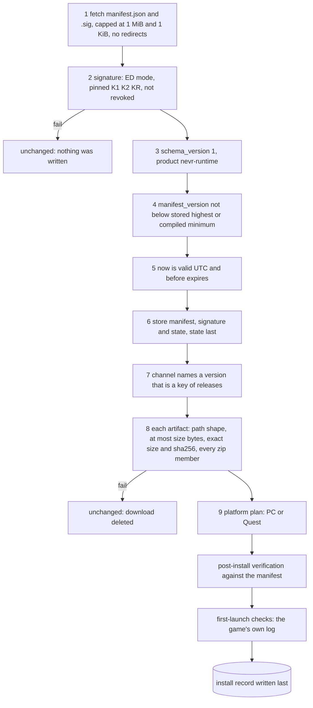
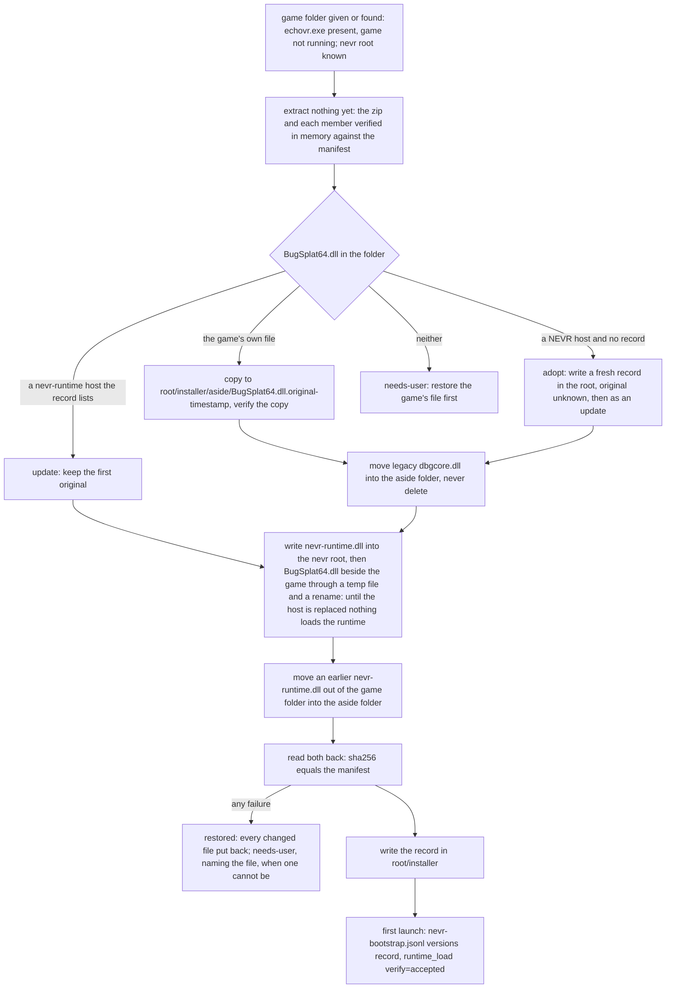
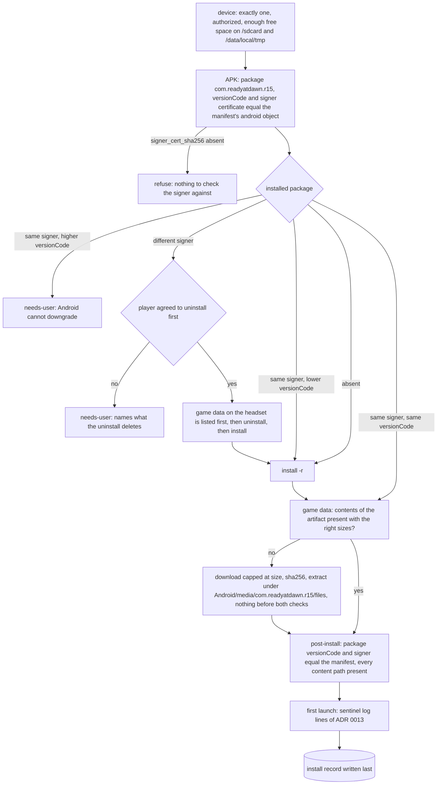
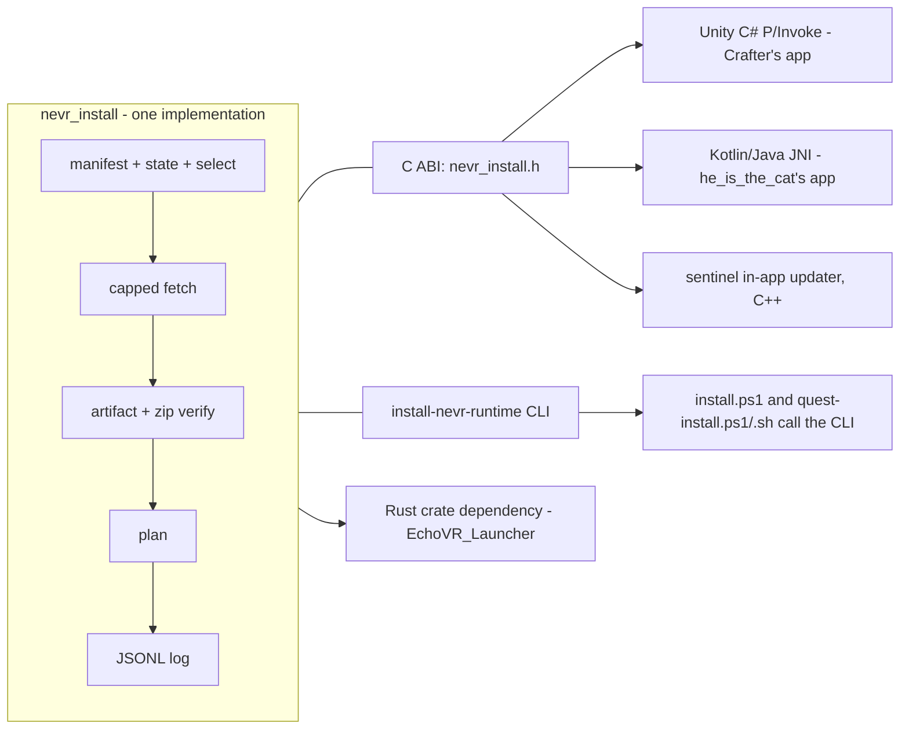

# ADR 0023: the core install method: every installer verifies the signed manifest, installs what it names, and ends in a known state

Status: proposed. Tracking issue: #1140. Builds on #898 (the signed manifest) and
`docs/reference/verifying-a-release.md` (the order of checks). Slice 1 of "Order of work" is built by the pull request that
adds this record; slices 2 to 4 are not. "What is not known" lists what no measurement in this tree covers.

## Requirement

Every installer of nevr-runtime on PC and on Quest uses one method, defined here and implemented once. A player who runs any
installer ends in a state this record names: `installed`, `unchanged`, `restored` or `needs-user`. Never a half-installed
game. No installer builds, patches or re-signs anything of its own: the files it puts on a machine are the files the signed
manifest names, byte for byte, and content changes only through signed manifest entries.

## Context

What each installer does today, read from its source (text only; nothing of anyone else's was built or run) and from this
tree. A `-` means the step does not exist.

| Step | `install.ps1` (this tree) | `quest-install.{sh,ps1}` (this tree) | he_is_the_cat's installer | Quest-EchoVR-Installer (Crafter) | EchoVR_Launcher (Mia) |
| --- | --- | --- | --- | --- | --- |
| Where it runs | PC, PowerShell | PC, adb | on the headset, Java | on the headset, Unity C# | PC, Rust |
| Reads `manifest.json` + `.sig` | - | - | - | yes, its own C# port of the 8 steps | - |
| What it trusts for the files | the zip's own `SHA256SUMS` | an APK hash typed in or read from a `SHA256SUMS`; a data hash compiled into the script | a hash in its own `update.manifest`, itself unsigned | the signed manifest | an unsigned `update.manifest`; its own Ed25519 key for its catalogues |
| APK | - | the one the player gives it | a patched APK built per player by a Discord bot | the signed `quest-apk` artifact | - |
| Signer mismatch | - | uninstall on `INSTALL_FAILED_UPDATE_INCOMPATIBLE` with `-Yes` | uninstall then install | `DifferentSigner` plan, Android's uninstall question | - |
| Game data | - | `/sdcard/readyatdawn`, from a compiled-in URL and hash | `Android/media/<pkg>/files`, unsigned zip | `Android/media/<pkg>/files`, the manifest's `game-data` artifact | - |
| Content changes | - | - | `add`/`del` lines from an unsigned list | the same unsigned list, held to a policy of host, size and folder | `add`/`del` lines; carries `BugSplat64.dll` alone |
| Log of what it did | `nevr-install.log` (text) | stdout | logcat | `installer.log` (text) | the launcher's own log |

The live manifest, fetched and verified with `minisign` against pinned key K1: `manifest_version` 4, `channels.beta` is 5.16.1.
Release 5.10.0 lists a `game-data` artifact (platform `android-arm64`, `data/echovr-data-fc2eedeacc50.zip`); release 5.16.1
lists `quest-library`, `quest-apk` and `windows-zip` and **no `game-data`**. An installer that, like Crafter's, takes the game
data from the channel's own release finds none on beta today.

Two layouts on the headset are in use: this tree's scripts write `/sdcard/readyatdawn`, both community installers write
`Android/media/com.readyatdawn.r15/files`. ADR 0013 decides which one the engine reads (the media root when it holds the
game's manifest and the data-root hook took, else the legacy root). That the engine reaches its menu from the media root
alone has not been observed on a headset (ADR 0013, Premise C).

## Decision

### 1. One method: nine steps, the same on PC and Quest

Steps 1 to 8 are the order of checks of `docs/reference/verifying-a-release.md`, unchanged. This record adds the three things
that document leaves to each integrator: the platform plans (steps 9 and after), the install record, and the log. The core is
the only implementation; an installer that cannot call it is a front end for a process that can (the CLI).

A release's artifacts are installed as a set or not at all (the document's step 7 rule). The set an installer needs per
platform:

| Platform | Artifacts | Notes |
| --- | --- | --- |
| PC | `windows-zip` | every zip member is checked against `contents` before any file is copied |
| Quest | `quest-apk`, `game-data` | `quest-library` is the loose shim and is not installed alone |

### 2. PC plan

The layout is ADR 0012's. The only file the plan writes beside `echovr.exe` is `BugSplat64.dll`, the host. The runtime goes to
`<nevr root>\nevr-runtime.dll`; the record `nevr-install.txt` and every set-aside file (`BugSplat64.dll.original-<stamp>`, a
legacy `dbgcore.dll`, an earlier `nevr-runtime.dll` beside the game, a stale record, a runtime that was already in the root)
go to `<nevr root>\installer\` and `<nevr root>\installer\aside\`. Nothing is deleted: a file that leaves the game
folder is copied, read back, and only then removed. The host is replaced by a temporary file in the game folder renamed over
it, so a reader sees the old host or the new one. The nevr root is `--nevr-root`, else `%LOCALAPPDATA%\nevr\echovr`; a `--nevr-root`
that is not that folder is refused unless the run passes `--dev-nevr-root` (the host loads from no other folder outside dev
builds, #1353); when neither is known the plan stops with `needs-user` before it fetches or changes anything. A record an earlier installer left
beside the game is read like the root's and is moved into the aside folder by the next successful install.

The record and the copy of the game's own `BugSplat64.dll` live only in the nevr root; there is no second copy in the game
folder. When the root is lost and `BugSplat64.dll` is a NEVR host (it carries the `NEVR-BUILD ` literal, or is this package's
own file) with no record, the plan is `adopt`: it installs like an update and writes a fresh record with `original=unknown`
and no `backup`. Nothing is refused, so update and uninstall keep working. The prior host's hash goes into `previous_sha256`.
If the game's own file is later put back (platform file verification), the record is stale, is set aside, and the next
install saves that file as the original. The game's own file has the pinned SHA-256
`618e34d3bfde69846c0202d42951366bff5e03cd2885b6825f55e09fb2cf160b` (build 34.4.631547.1, 630,288 bytes). An uninstall with no
saved original ends `needs-user` with `recovery_without_original()`: verify the game's files on the platform, and if
verification doesn't restore it, reinstall the game; the hash lets a copy be checked first. The core has no uninstall yet
(`uninstall.ps1` does that); the text and the `original` key are in place for it. The install logs `host_original` with
`state` (`saved`, `unknown` or `kept`) and, for `saved`, whether the file matches the pinned hash.

The record keeps the keys `uninstall.ps1` reads (`backup`, `legacy`, `runtime_aside`, `runtime_legacy`, `runtime_root`,
`installed_sha256`, `runtime_sha256`, `previous_sha256`) and adds `game_dir` and `release`. An installed `release` newer than
the offered one is refused (`needs-user`) unless the caller passes `--allow-downgrade`; versions compare as numbers.

A failure after the first change takes every change back, newest first, and ends the run `restored`. A change that cannot be
taken back is logged (`restore_failed`) and the run ends `needs-user` with the file named and the aside folder pointed at; a run
is never `unchanged` or `restored` while the folders differ from what they were. The files that are installed come from one
read of the zip: it is hashed whole against the manifest and each member against its `contents` entry, and the final read-back
compares the folders with those same hashes.

**The package folder.** An installer that ships beside the two DLLs (the Windows zip) passes the folder it sits in
(`--package-dir`). The core then reads `BugSplat64.dll` and `nevr-runtime.dll` from it and compares their size and SHA-256
with the `contents` entries the signed manifest lists for the chosen release. When both match, those bytes are what is
installed and nothing is downloaded (`package_local ok=true`). When either is missing or differs, the files in the folder
are not used at all, the `windows-zip` the manifest names is downloaded and checked as usual, and the record says why
(`package_local ok=false reason=...`). The manifest, not the folder, is the authority: a folder cannot make the core install
bytes the manifest does not list.

**Offline.** When the manifest cannot be fetched (a network failure at step 1, not a failed check), the core re-verifies the
pair it stored on an earlier run against the pinned keys, the stored version floor and the clock, and uses it when it is
still valid (`manifest_check ok=true source=stored`). A stale copy, or none, ends the run `unchanged` with the network error.
An install from the package folder therefore works offline after one online run, and stays verified.

### 3. Quest plan

A signer mismatch means uninstall first, with the player's consent, because Android refuses an in-place update across
signers; both existing Quest scripts and Crafter's installer already do this and none lists what the uninstall deletes. The
core's plan lists it (`/data/data/<pkg>`, `/sdcard/Android/data/<pkg>`, the OBB) and states whether `Android/media/<pkg>`
exists, because whether it survives an uninstall was not measured (#965).

**How the plan learns the installed signer.** On the headset an app reads the package's signing certificates through
`PackageManager` and reports their SHA-256 digests. Over `adb` it cannot: `dumpsys package com.readyatdawn.r15` on the test
headset (Quest 2, Android 14) prints `signatures=PackageSignatures{... signatures:[999834e1] ...}`, a hash code of the
signature set and not the certificate digest the manifest carries. The adb backend therefore checks the APK's own signer on
the host (`apksigner verify --print-certs`, refused when absent) before installing, installs with `-r`, and reads
`INSTALL_FAILED_UPDATE_INCOMPATIBLE` as "different signer"; the plan's `observed` says `signer: unknown-until-install` for
that backend.

**Game data counts as present in either root.** The same headset holds a complete `_data` under `/sdcard/readyatdawn` and
an empty `Android/media/com.readyatdawn.r15`. A plan that required the media root would download 930 MB onto a working
install on the strength of an unobserved premise, so presence is checked in both roots (every `contents` path with its
size), and a download happens only when neither holds the data; it goes to the media root. When the chosen release lists
no `game-data`, the check uses the newest `game-data` the manifest lists, because one copy of the data serves every release.

**Game data goes to the media root**, where the community installers already put it, which needs no storage permission
(ADR 0013), and which a player who moves between installers therefore keeps. The destination is one value of the plan
(`data_root`), so the first headset observation of Premise C can move it to the legacy root without touching any caller.
Until that observation, the first-launch check for Quest names the log lines that decide it (ADR 0013, "What the first
headset run must show"): `data_root` with `source=android_media`, `data_check action=use`.

### 3a. A local tester APK: `--artifact-dir`

Testers and developers install an APK built on their own machine (`just package-dev`, `just android-repack-apk`), which no
manifest names. `install-nevr-runtime quest install --artifact-dir DIR` installs it, with its own checks in place of the manifest's:

- `DIR` holds exactly one `.apk` and a sidecar for it: `<name>.apk.sha256`, or a `SHA256SUMS` with exactly one line for the
  file. No sidecar is a refusal. The file's SHA-256 must equal the sidecar's.
- `aapt2` must read package `com.readyatdawn.r15` and a versionCode from it, and `apksigner verify` must accept it and print
  at least one signing certificate. The plan then runs the Quest plan of section 3 with those values in place of the
  manifest's `android` object: the downgrade rule, the uninstall consent and the signer handling are unchanged.
- The game data still comes from the signed manifest.
- Every record the run writes after the manifest check (`dev_artifact`, `plan`, each `step_start` and `step_end`,
  `artifact_use`) carries `trust: "unverified dev artifact"`, and the install record says `dev_artifact: true`. The file is
  hashed again just before the install, so a change after the checks is refused.

The option is for developer tools only: `tools/quest-install.sh` and `just quest-install` pass it when given a directory, or a `.apk` file (staged with a sidecar
written from its bytes);
no installer a player is handed (`install.ps1`, `quest-install.ps1`, the other projects' installers) passes it, and a test
reads their sources for it. It never relaxes the manifest chain: an unverified manifest still stops the run first.

### 4. The `game-data` kind and what release-signer adds

The kind exists in the schema and the live manifest (`internal/manifest/gamedata.go` in release-signer: `data/<name>.zip`,
named by the first 12 hex digits of its sha256, "one copy serves every release", `contents` with a hash per file,
`game_data.data_version` and `echo_build`). This record fixes how a consumer uses it:

- A release lists one `game-data` artifact per platform (`android-arm64` for the headset, `windows-x86_64` for the PC). A
  consumer selects the entry of its own platform, by `kind` and `platform` together, and refuses zero or two entries for
  that platform with a message that names the release. An entry of another platform never decides anything for it. The
  core's `NevrArtifactVerifyZip` takes the platform like `NevrArtifactFetch` and refuses a `game-data` call that names
  none, because the kind alone selects no single artifact.
- The Quest game data is the `android-arm64` entry, named `echovr-data-<12hex>.zip`. A consumer extracts only paths listed
  in `contents`, all of the form `_data/<data_version>/rad15/android/(manifests|packages)/<name>`.
- The PC artifact is specified as follows; the signer publishes it once release-signer#69 lands. The PC game data is the
  `windows-x86_64` entry, named `echovr-data-win10-<12hex>.zip`, at `data/<name>` like the Quest one. It holds
  `_data/<data_version>/rad15/win10/(manifests|packages)/...`, and a consumer extracts only paths listed in its
  `contents`. Its verification basis is a set of hashes pinned in the signer's configuration and the zip's own
  consistency: the manifests pin the size of each package they name. No official reference for the PC data exists, so the
  release notes state that the PC data was not compared with one. The first publish of a PC game-data artifact is checked
  by a second seat before the release is announced.
- Presence is decided from `contents`: every listed path exists with the listed size. The core does not rehash 930 MB of
  data on every start; the hash check is on the download.

**release-signer must add** (`thesprockee/release-signer`, owner's repository; this record only specifies it):

1. **Carry game data forward on publish.** A publish of a Quest release that supplies no `put-game-data` claim copies the
   `game-data` artifact of the release the channel named before it, re-verified the way a promote already does
   (`ExtraInputsOf` reads each from R2 and inspects it again). Today only a publish that is handed the claim lists the
   artifact, which is why 5.16.1 has none. A release whose data version changed carries the new one.
2. **A `content` kind** for what the community installers deliver as `add`/`del` lines: files under `asset_patches/` and
   `files/` of the media root, each listed in `contents` with sha256 and size, a `target` of `media-files`, no `.so`, `.dex`,
   `.apk`, `.jar`, `.dll` or other program file, no hidden file, at most the same limits Crafter's policy holds today (256 KB
   list, 1000 entries, 128 MB per file, 512 MB in all). A `del` is a signed `removes` list of paths. Optional members, so
   `schema_version` stays 1 (the document's step 3 rule: unknown members are ignored by an older consumer).
3. **`requires`** on a `content` artifact naming the `data_version` it applies to, so content is never applied to other data.

### 5. Install record and log

Every run, success or failure, writes JSONL records through one function (`nevr_install::log`), one line per event, to a
file under the installer's state directory that no run truncates, with the tag `[NEVR.INSTALL]` (the value of the record's
`tag` field, as `[NEVR.HOST]` does for the host). A record carries: `run_id`, `ts`, `level`, `event`, `step` (1 to 9),
`platform`, and the fields of the event. A record never carries a secret or a response body (`docs/standards/logging.md`,
Rule 4); a URL is logged, a token never is.

A failed install must explain itself from the log alone. The events that MUST exist:

| Event | Fields |
| --- | --- |
| `run_start` | `channel`, `manifest_base`, `core_version`, `min_manifest_version`, `mode` |
| `manifest_fetch` | `url`, `bytes`, `status` |
| `manifest_check` | `step`, `ok`, `reason` (the `FAIL step N` text), `key_id`, `manifest_version`, `stored_highest` |
| `release_selected` | `channel`, `version`, `artifacts` (kind, path, size, sha256) |
| `artifact_fetch` | `kind`, `url`, `size`, `bytes`, `sha256`, `ok`, `reason`, `resumed_from` |
| `plan` | `platform`, `steps` (the ordered list), `installed` (what was observed), `decision` |
| `step_start`, `step_end` | `step_id`, `ok`, `reason`, `elapsed_ms` |
| `file_write` | `path`, `sha256`, `replaced_sha256`, `set_aside` |
| `device` (Quest) | `serial_fp`, `model`, `android_sdk`, `free_kb` per partition, `package` versionCode and signer fingerprints |
| `consent` | `what` (`uninstall`), `given` |
| `verify_installed` | `ok`, `expected`, `observed` for each checked fact |
| `launch_check` | `ok`, `witness` (the game's own line that proved it), `file` |
| `run_end` | `state` (`installed`, `unchanged`, `restored`, `needs-user`), `reason`, `elapsed_ms` |

The record is `install-record.json` (Quest: in the media root beside `files`; PC: beside the state file), written last by a
temporary file and a rename: release version, `manifest_version`, `last_manifest_sha256`, each installed artifact's sha256,
the layout, and the time. A record that exists means the run reached `installed`; no record with files present means the
run did not finish, and the next run starts from the plan, never from the record.

Failure to write the log is a failure of the run (`run_end state=unchanged` is only claimed when the log could say so): the
core refuses to change anything when it cannot open its log.

### 6. Shape: a Rust library with a C ABI, and a thin CLI

Why one Rust library and not a copy per language: the verifying document already carries a shell, a Rust and a C#
implementation of steps 1 to 8, and each has to be re-reviewed and re-tested when a check changes; Crafter's C# port exists
because there was nothing to call. A single implementation is reviewed once. Rust because (a) the two reference
implementations that the document tests are Rust and C#, and the Rust one is the shorter and carries a pinned dependency
set, (b) Mia's launcher is a Rust crate and takes the library as a dependency, (c) the same source builds the library for
Windows, Linux and `aarch64-linux-android` (Unity loads a `.so`; a JNI app loads one the same way), and (d) there is no
runtime to ship. Why a CLI as well as a library: our own installers are shell and PowerShell and the PC installers of others
may be anything; the CLI is the same code, with the same exit codes and the same log, and needs no binding.

**The C ABI** is `installer/include/nevr_install.h`: opaque handles, UTF-8 strings, no callbacks that cross a thread, every
function returns a `NevrStatus` and writes details to the log. Names follow the published-ABI rule of
`docs/standards/naming.md` (`Nevr*` types and functions, `NEVR_*` macros). The surface:

| Function | What it does |
| --- | --- |
| `NevrInstallOpen(config_json, &session)` | `platform`, state directory, base URL, channel, pins, minimum manifest version, log file; refuses when the log cannot be opened |
| `NevrManifestFetch` / `NevrManifestVerify` | steps 1 to 6 on the base URL, or on bytes the caller holds |
| `NevrReleasePick(session, channel, &json)` | step 7: the version and its artifacts |
| `NevrArtifactFetch(session, version, kind, platform, out_path)` | step 8 for one artifact; deletes the file on failure |
| `NevrArtifactVerifyZip(session, version, kind, platform, zip_path, allow_dirs)` | every member against `contents`; `platform` selects the entry (it may be null except for `game-data`, which lists one artifact per platform) |
| `NevrPlanBuild(session, version, observed_json, &plan_json)` | the Quest plan as data, from what the caller observed; the caller executes the steps it owns (a package install on a headset) |
| `NevrRunEnd(session, state, reason)` | writes `run_end`; the state is one of the four |
| `NevrLastError`, `NevrStringFree`, `NevrClose`, `NevrCoreVersion` | the last failure's text, freeing a returned string, closing, the library version |

The PC plan and its execution are reached through the CLI (`install-nevr-runtime pc install`; the binary is `install-nevr-runtime.exe`, while the
library, its C header and the install record keep the `nevr_install` and `nevr-install.txt` names), which is what PowerShell and every
other PC installer calls; the library exposes the Quest plan because the on-headset callers cannot run a CLI. Step results
of a caller-executed step are recorded by the caller's own `NevrRunEnd` reason in this slice; a per-step report function
is a later addition and not part of this ABI.

**How a Unity installer calls it.** The library is built as `libnevr_install.so` for `aarch64-linux-android`, placed in
`Assets/Plugins/Android/arm64-v8a/`, and declared with `[DllImport("nevr_install")]`. Strings go through `IntPtr` with
`Marshal.PtrToStringUTF8`; the calls run on a worker thread, never the Unity main thread. The step the app must do itself
is the package install: it asks Android for the file's package, versionCode and signer (`PackageManager`), reports them as
`observed_json`, and hands the verified APK to the package installer. Crafter's `NevrManifest*` classes and
`NevrQuestRelease` are replaced by these calls; his test fixtures in its `Tests~` folder become the core's test vectors.
IL2CPP on a headset is untested (his README says the same of his own C#), and so is this binding: it is not built here
(no Android target in this toolchain).

### 7. In-app updates: NEVR checks the manifest itself

The running game checks the signed manifest and updates itself, in two layers with different mechanisms and different
evidence.

**Layer 1: content, with no reinstall.** Game data and `content` artifacts are files under the media root. The updater (the
sentinel, calling the core through the C ABI) runs steps 1 to 8 for the `content` and `game-data` artifacts of the channel's
release and writes only listed paths. It changes no code, which is also what ADR 0021 requires (no code page is written at
run time). It supersedes ADR 0013's Design 2, 4 and 7 where they say a release build never fetches: a release build may
fetch, from the signed manifest only, never a name the build carries, and the message of ADR 0013 stays for the case where
the fetch cannot run. Whether the game may write its media directory without a storage grant is not established here (see
"What is not known").

**Layer 2: a new APK.** The updater downloads the `quest-apk` artifact (steps 1 to 8), compares the APK's package,
versionCode and signer with the manifest (`aapt2`-equivalent read in the core) and hands the file to Android's
`PackageInstaller`. What was established, and how:

| Question | Answer | How it is known |
| --- | --- | --- |
| Does the platform have a package installer UI that a non-system app can reach? | Yes. `com.android.packageinstaller/.InstallStart` is the resolver for `android.intent.action.INSTALL_PACKAGE` | Quest 2, Android 14 (SDK 34): `cmd package resolve-activity --brief -a android.intent.action.INSTALL_PACKAGE ...` on the test headset |
| Is "install unknown apps" a per-app grant on Horizon OS? | Yes. `appops get <pkg> REQUEST_INSTALL_PACKAGES` reports `allow` for a third-party file manager, `No operations` for apps that never used it | same headset, `appops` |
| Does our APK declare `REQUEST_INSTALL_PACKAGES`? | No. The requested permissions are `INTERNET`, `MODIFY_AUDIO_SETTINGS`, `ACCESS_NETWORK_STATE`, `WRITE_EXTERNAL_STORAGE`, `READ_EXTERNAL_STORAGE`, `RECORD_AUDIO`, `POST_NOTIFICATIONS`, `READ_MEDIA_*` | `dumpsys package com.readyatdawn.r15`, versionCode 51602002, targetSdk 29 |
| What does the repack do to the manifest today? | Writes the 4-byte versionCode only (`tools/quest_apk_version.py patch-manifest`); declaring the permission is a new, larger edit of the compiled manifest | `justfile` recipe `android-repack-apk`, step 4b |
| Will the install need the player's confirmation? | **Yes, every time, on this OS.** The documented no-prompt conditions need the app being installed to target API 31 or higher on Android 14; ours targets 29. (They also need `USER_ACTION_NOT_REQUIRED`, `REQUEST_INSTALL_PACKAGES`, and the installer to be the update owner, the installer of record, the app itself, or to hold `UPDATE_PACKAGES_WITHOUT_USER_ACTION`.) | `PackageInstaller.SessionParams.setRequireUserAction`, Android API reference, read in full on 2026-10-28 |
| Does Horizon OS draw that confirm prompt for a sideloaded game updating itself? | **Not established.** The stock UI exists and an on-headset installer (he_is_the_cat's) opens the same prompt and waits up to 5 minutes for the player (`TesterBundleInstaller.installViaSessionAndWait`), but nobody watched a prompt draw over a running game | the installer's source, read; no run |
| Can the game receive the install's status? | **Not established.** `PackageInstaller.Session.commit` needs an `IntentSender` and the player's confirmation arrives as `STATUS_PENDING_USER_ACTION` with an intent to start; the sentinel ships no dex (ADR 0013) and the game's activity is the stock one, so a receiver needs code the APK does not carry | design reading of the sentinel; no run |
| Does the process survive? | No: replacing the package ends the process; the updater must have finished everything else first | `PackageInstaller` behaviour; not measured here |

So layer 2 is possible only with: `REQUEST_INSTALL_PACKAGES` added to the repack's manifest edit, a small piece of Java in the
APK (a dex added by the repack, or an in-memory dex) to start the session and receive the status, the player's one-time
"install unknown apps" grant, and a confirm prompt at every update. It cannot be silent until the APK targets API 31+, which
changes behaviour of the whole game (storage, background rules) and is its own decision. The first slice (below) does not
depend on layer 2.

**Loading a newer runtime `.so` from app storage is not part of this design, and is not established as possible at
targetSdk 29.** What is known: the Android 10 behaviour changes state that apps targeting Android 10 "cannot invoke
`execve()` directly on files within the app's home directory", that apps "should load only the binary code that's embedded
within an app's APK file", and that a library opened with `dlopen` cannot be modified in memory with the change written
through to the file; the Android 14 rule that dynamically loaded files must be read-only applies to apps targeting API 34
and is not stated for native libraries. ADR 0021 measured the one nearby case on two headsets: a private file mapping that
was written and then made executable is denied (`avc: denied { execmod }` for `libr15.so`). Whether `dlopen` of a `.so`
written into the app's files directory is allowed on this OS is the open question P3 of ADR 0019, never run. Code therefore
changes only through layer 2.

### 8. What replaces each of he_is_the_cat's features

The pull request to that installer removes the first two rows' mechanisms and keeps what players use.

| His feature | What replaces it | Notes |
| --- | --- | --- |
| Discord sign-in, a bot builds a patched APK per player | The `quest-apk` artifact: one APK we sign, the same for every player, whose signer certificate the manifest names | Retired only after #943, #944 and #945 land ("Retirement gate" below) |
| "I already have an APK link" (paste a URL) | Removed at the retirement gate below: an APK that is not the manifest's is not installed | A tester build is a local file, installed with the CLI's `--artifact-dir` (section 3a), never a URL |
| `update.manifest` `add`/`del` of asset files (Graphics Patch and the like) | `content` artifacts (section 4) | #943: our APK carries the Graphics Patch setting, so the first use of his patch list is covered without a patch file |
| `BASE_APK` hash and the two APK mirrors | `quest-apk` of the channel's release | |
| Game data download with resume | `game-data` artifact; resume with `Range`, only a `206` for exactly that range is accepted, then the whole file is hashed from disk | Crafter's installer already does this; the core takes the same rule |
| Installer self-update from GitHub releases | Stays his: the core does not update installers | |
| Maintenance (reinstall data, clear cache, uninstall) | The core's `repair` (re-run the plan with `force`) and the CLI's `uninstall` plan | |
| Enhanced-graphics APK (a second, patched APK) | Removed; the texture setting is in our APK (ADR 0015) | |

**Retirement gate.** The per-player patched APK and the pasted-APK-link path are removed from his installer only after #943,
#944 and #945 are closed with their headset proofs. Until then the installer offers the signed path (the core) as the
default for a new install and keeps the old path behind an explicit choice, labelled as unsupported by the project, with no
change to how it builds its APK. What a player on the signed APK does not have until each issue lands (each item is the
issue's own statement; none was measured on a headset for this record):

| Issue | What a player lacks before it lands |
| --- | --- |
| #943 | The "Graphics Patch" setting that the community patch repo's patcher offers; our APK does not carry it |
| #944 | A proof, site by site, that the 8 entitlement patches and 70 license-overlay sites of the community patcher are covered by our login hooks. Our APK reaches the same login by hooks (`src/quest/login/`), so login is expected to work; the issue's falsifier is a site that is reached and not covered, and none has been looked for |
| #945 | The "Quest S version" patch (the function at the patch repo's `0x010875c4` returning 0). What it changes for a player, and whether our build reaches the same outcome by another route, is not known |

### 9. What an installer must not do

No installer builds, patches, re-signs or repacks an APK or DLL; fetches an artifact by a URL the manifest does not name;
accepts an APK whose signer the manifest does not name; applies a file list that is not a signed `content` artifact; writes
into a game folder before every check of the set has passed, or (on PC) writes there anything but `BugSplat64.dll`; or ends a
run without a `run_end` record.

## Tests, failing first

Each is run once with the line it covers changed, and must fail (the mutant discipline of `AGENTS.md`).

1. Steps 1 to 8 against the fixtures of `docs/reference/release-verification/` and the vectors of the "Test vectors" table:
   every row of that table is a test; the live manifest (fetched, then stored as a fixture signed by the real key) passes
   with the real pins.
2. The Quest plan: one test per branch of the diagram (absent, same signer lower/equal/higher, different signer without and
   with consent, no `signer_cert_sha256`).
3. The PC plan against a temporary game folder and a temporary nevr root: first install, update, adopting a NEVR host with no record (also the package's own host, and an adopted install's update and
   its failure), a stranger's `BugSplat64.dll`,
   the game folder holding only `echovr.exe` and `BugSplat64.dll` afterwards, a failure injected after each file (both folders
   return to their prior bytes), a restore that fails (reported, never `restored`), an older release over a newer one, and the
   state file read by the real `uninstall.ps1` logic's keys.
4. The log: a run that is made to fail at each step writes `run_end` with the state and the reason; an unwritable log refuses
   to change anything.
5. The C ABI from a C program (not Rust): open, verify a fixture manifest, pick, build a plan, report, close.
6. A source check that no installer in the tree contains a hash, a URL or a version of its own for a release artifact
   (`tools/tests/test_installers_use_core.py`), and that no installer a player runs passes `--artifact-dir`.

## Prediction

Written before the first run. Slice 1's CLI against the live manifest, with a scratch state directory:

- `install-nevr-runtime manifest verify` reports `ok` with key id `c0ee9c8547023d34` (file order; K1 prints as 343D0247859CEEC0),
  `manifest_version` 4 and release 5.16.1 on `beta`, and writes a state directory holding `manifest.json`,
  `manifest.json.sig` and `state.json`.
- `install-nevr-runtime quest plan` for 5.16.1 reports `game-data: none in release` and never ends `installed`, until
  release-signer carries game data forward (section 4, item 1). That is the live defect this record finds.
- `install-nevr-runtime quest plan` for 5.10.0 reports the APK (versionCode 51000999) and the game data (937395400 bytes).
- The same plan against the test headset reports the installed versionCode, the signer as `unknown-until-install`, the game
  data as present in `/sdcard/readyatdawn` (the media root is empty), and `decision: downgrade-refused`.

Falsifiers: any `manifest_check ok=false` on the live pair; a plan for 5.16.1 that names game data; a plan that would
uninstall without consent.

**Result** (run on the build of the pull request that adds this record, `--from-dir` the live pair, plan only, no install):

- `manifest verify`: exit 0, `manifest_check ok=true key_id=c0ee9c8547023d34 manifest_version=4`, state directory with the
  three files, `channel beta -> 5.16.1`.
- `quest plan --no-device`, 5.16.1: `needs-user`, `game-data: none in release 5.16.1`, no steps.
- `quest plan --no-device`, 5.10.0: `proceed`, steps `fetch-apk, check-apk, install-apk, fetch-data, extract-data,
  verify-installed`, game data `data/echovr-data-fc2eedeacc50.zip` (937395400 bytes).
- Against the headset (Quest 2, Android 14, installed versionCode 51602006): `device` record with `signers:
  unknown-until-install`, `data_present {legacy: true, media: false}`; both 5.16.1 (versionCode 51601999) and 5.10.0
  (51000999) end `needs-user` with `downgrade-refused`; no uninstall step in either plan.
- One prediction was incomplete, and the run showed it: with no `game-data` in the chosen release there is nothing to check
  presence against, so the first run called the data absent on a headset that holds it. The core now checks the device
  against the newest `game-data` the manifest lists when the chosen release lists none (`latest_game_data`), and says so.

## What is not known

- That the engine reaches its menu from the media root alone (ADR 0013, Premise C), so the Quest data destination is a
  default, not a measurement.
- Whether `Android/media/<package>` survives an uninstall (#965 closed without that measurement).
- Whether the game may write its media directory without a storage grant, which layer 1 needs.
- Whether Horizon OS draws the package-installer confirmation for a game updating itself, and how the status gets back to
  native code (layer 2).
- That `dlopen` of a `.so` in app storage works at targetSdk 29 (ADR 0019, P3). The design does not use it.
- That the library builds and loads for `aarch64-linux-android` and under IL2CPP: this toolchain has no Android Rust target
  or NDK, so the binding is specified and not built.
- What a player loses when the per-player patched APK is retired before #944 and #945 land.

## Order of work

Each slice is its own pull request with its own issue, mergeable and testable alone.

1. This record, and the core: `installer/` (library, C ABI, CLI), the manifest chain, the artifact checks, the PC plan,
   the Quest plan over `adb`, the log, and the tests above.
2. `install.ps1` and `quest-install.{sh,ps1}` call the CLI and lose their own hashes and URLs; `package-release` ships the
   CLI in the Windows zip (its own `contents` entry, covered by the manifest).
3. release-signer: carry-forward of game data (in progress in release-signer), the `content` kind, `requires` (section 4).
   Then pull requests to he_is_the_cat's installer (core first, the old path behind a choice until the retirement gate of
   section 8 passes), Crafter's and Mia's.
4. The in-app updater (layer 1), then layer 2 after its open questions are measured on a headset.
