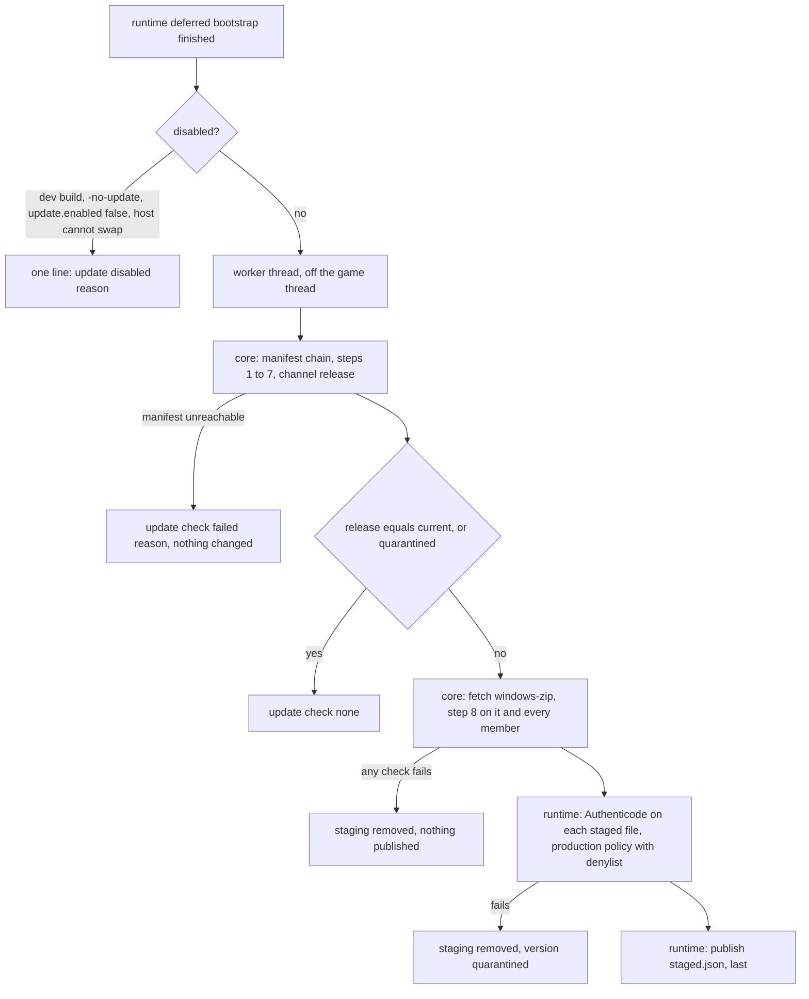
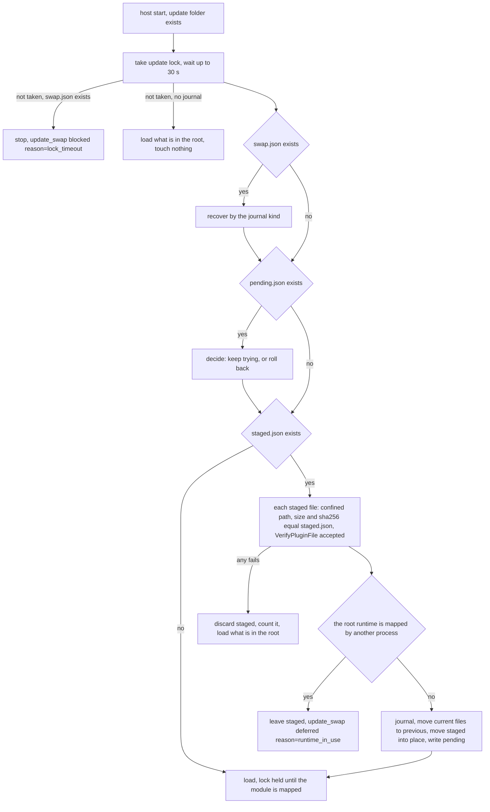

# ADR 0024: PC self-update: the runtime stages a verified release in the nevr root, the host swaps it in at the next launch

Status: proposed. Tracking issue: #1200. Builds on ADR 0012 (the static install folder and the nevr root, #575) and ADR 0023
(the core install method and its C ABI, #1140). **It amends ADR 0012 in one place:** "A last-known-good copy of
`nevr-runtime.dll` is out of scope until there is a reason for one" no longer holds; "The root" gains the `update\` folder
of "Layout". Nothing in this record is built when it is written, and it assumes #855 (the runtime loads from the root; today the host takes it from the game folder); "What is not known" lists what no measurement covers.

## Requirement

A player on PC runs the build their channel names, without running an installer. At start the runtime finds out whether the
signed manifest names a different release for its channel, downloads it, and checks it. At the next launch the host puts it
in place and loads it. Four things hold in every case:

1. **Nothing is written into the game folder.** Every file this record moves lives under `%LOCALAPPDATA%\nevr\echovr`, so no
   administrator right is needed and a `Program Files` or Steam install stays untouched.
2. **Nothing unverified runs.** A file that is loaded was named by the signed manifest (sha256, size), carries the release
   signer's Authenticode signature (the ADR 0010 verifier), and passed both checks again by the host after it sat on disk.
3. **A runtime that does not start is replaced by the one that did.** The player is not left without a working runtime,
   and a release that failed is not offered again.
4. **Every case above and below leaves a log line that proves it** ("Failure cases").

## Context

What exists, read from this tree:

- The host loads `nevr-runtime.dll`, verifies it with the pinned Authenticode policy and calls its `initialize`
  (`src/runtime/host/runtime_load.cpp`, `RuntimeLoader::Load`). Any outcome but `kLoaded` ends the game (`DegradedAction`
  is `stop_game`, exit 78). Nothing in the host looks for a different runtime, and nothing puts one back.
- The ABI between the two DLLs is `src/core/runtime_abi.h`: `abi_major` mismatch is a hard reject (`ValidateRuntimeApi`),
  minor versions only append, and `kMinor` is one constant both descriptors carry. The host hands the runtime a
  `NevrHostContext` (size pinned at 72 bytes) with no field that says what the host can do.
- A failed runtime stays mapped in production: the host never frees it (`src/runtime/lifecycle/dllmain.cpp`, the comment on
  `DLL_PROCESS_DETACH`). The host's policy (`PinnedPolicy`, `src/runtime/ext/plugin_pins.cpp`) has an empty denylist.
- The root (`src/core/nevr_root.h`: `kRoot`, `kLogs`, `kCrashes`, ...) is `%LOCALAPPDATA%\nevr\echovr`. ADR 0012 puts
  `nevr-runtime.dll` at its top and plugins in `plugins\` (plugins still load from the game folder until #856); the host links no core state (`tools/verify_host_no_core_state.py`).
- The host's crash capture (`src/runtime/host/crash_capture.cpp`) runs inside the faulting process and writes with raw
  Win32 calls; the same rule holds for any file it touches (AGENTS.md N70 states the same rule for the runtime's own crash path).
- ADR 0023 defines the core: the manifest chain of `docs/reference/verifying-a-release.md` (steps 1 to 8: signature, schema,
  version floor, expiry, channel to release, every artifact and zip member), the log, and a C ABI. The core is a Rust
  library; the PC plan is reached through its CLI only. ADR 0023 section 7 designs the in-app updater for Quest and says nothing
  for PC.
- The Windows zip a release lists is about 6.5 MB and lists, as members, `BugSplat64.dll`, `nevr-runtime.dll`,
  `echovr_server.exe`, the scripts and the docs. It lists no plugin, and `tools/package_release.py` packages none.
- Release signing covers `BugSplat64.dll` and `nevr-runtime.dll`. It does not sign plugins (N147).
- The manifest has a `beta` channel; a `stable` channel next to it is being added, with installers defaulting to it.

## Decision

### 1. What updates, and what never does

| File | Updated by self-update | Why |
| --- | --- | --- |
| `nevr-runtime.dll` in the root | yes | it is the part that changes (ADR 0012) |
| plugin DLLs this updater put in `plugins\` | yes, when the release lists them and they are signed | see "Plugins" |
| `BugSplat64.dll` (the host) | **no** | it lives in the game folder, and it is the trust anchor; only the installer replaces it |
| `echovr_server.exe`, the scripts, the docs, `nevr-install.exe` | no | they are not loaded by the game |
| anything a player or a third party put in `plugins\` | never touched | not in the ownership list ("Ownership") |

The host and runtime are a matched pair behind one versioned ABI (ADR 0008). A release whose runtime needs a newer host
cannot be reached by self-update: the new host must come from the installer. Self-update does not try to detect that
beforehand; the load does (`abi_rejected`, `load_failed`), and "Start confirmation and rollback" puts the working runtime
back and remembers the refusal. A player on a build older than the first release that carries this record has no swap in the host and runs the
installer once.

### 2. Layout: `update\` in the root

| Path under the root | Written by | What it is |
| --- | --- | --- |
| `update\state.json` | host, runtime, installer (under the lock, by rename) | `channel`, `current` (version, runtime sha256), `owned` (relative path and sha256 of each file self-update placed), `discards` (count per release), `quarantine` (version, runtime sha256, reason, time) |
| `update\staging\<version>\` | core | the verified members of one release, complete or absent (built as `<version>.partial-<pid>`, renamed when every member passed) |
| `update\staged.json` | runtime | published last: the release, its files and their sha256; its existence is the signal "there is something to swap" |
| `update\previous\<version>\` | host | the files the last swap moved out, one generation |
| `update\failed\<version>\` | host | the files a rollback moved out, kept for the report that follows |
| `update\pending.json` | host | a swapped release not yet confirmed started: `to`, `from`, `boot_attempts`, `failed_reason` |
| `update\crashed` | host crash capture | an empty file; the swapped release crashed while `pending.json` existed |
| `update\swap.json` | host | the journal of a swap or rollback in progress |
| `update\lock` | host, runtime, installer | held from the host's first read of `update\` until its runtime is mapped, and around every write to `update\` |
| `update\manifest\` | core | the updater's own copy of the manifest, signature and version floor (the core's state directory) |
| `logs\nevr-update.jsonl` | core | the core's `[NEVR.INSTALL]` records for the updater's runs |

The runtime stays at the top of the root and plugins stay in `plugins\`: the layout of ADR 0012 and the paths the host
resolves do not change (#855, #856). `update\` is new and holds only what self-update needs.

### 3. The check

- **When.** Once per launch, on a worker thread the runtime starts after its deferred bootstrap (client: the graphics
  device exists; server: after the first original call), never in `DllMain`, never on the game thread, never before the
  boot-state limit of N146 is passed. The worker is bounded: manifest and artifact caps are the core's (1 MiB, 1 KiB, the
  entry's `size`), connect timeout 10 s, 120 s for the whole stage, one attempt. A failure ends the worker; the next launch
  tries again. The game never waits for it.
- **What it stages.** The release the channel names. It is the current one when the version string and the runtime's sha256
  in the entry's `contents` both equal the running runtime's, and then nothing is fetched. Otherwise it stages the release,
  in either direction: a withdrawn release is replaced by the older one the
  channel points at, because that is the only way a bad release is taken back from players. The log says `direction`.
  Release builds only: a dev build (`NEVR-PLUGIN-TRUST dev`) never updates, so a developer's runtime is not replaced by a
  signed one.
- **Which channel.** `update.channel` in `config.yaml`, else the channel recorded in `update\state.json` by the installer
  that installed the runtime (`pc install --channel`), else the core's default. A player who installed from `beta` stays on
  `beta`.
- **Off switches.** `update.enabled: false` in `config.yaml` and the `-no-update` flag, both for operators and testers.
  They are two new config keys and one new flag; the flat key map count of N133 and the flag registry change with them.
- **A host that cannot swap.** The host context gains a `capabilities` word (appended after `reserved`; `kMinor`
  becomes 2; read only when `DescriptorCovers` proves it). Bit 0 means "this host performs the staged swap". A runtime started by an older
  host sees no bit and stages nothing, so a 6.5 MB download that nothing would apply never happens.

**The C ABI addition** (ADR 0023 section 6 table gains a row): `NevrPcStage(session, root_dir, current_json, &result_json)`.
`current_json` is the running runtime (version, sha256) and the quarantine list; `result_json` is
`{"action":"none"|"staged"|"blocked","version","direction","files":[{"path","size","sha256"}],"reason"}`. The function runs
steps 1 to 8 for the channel's `windows-zip`, extracts exactly `nevr-runtime.dll` and the members under `plugins/` into
`update\staging\<version>.partial-<pid>`, re-reads each file and compares size and sha256 with the entry's `contents`, and
only then renames the folder to `<version>`. A member not listed, a member whose name is not a plain relative path, or a
second `windows-zip`, is a refusal. The CLI gets the same operation as `nevr-install pc stage --root DIR` so the test and an
operator can run it without the game. The core is linked into `nevr-runtime.dll` as a static library: one signed file, no
extra DLL for the plugin gate to verify. The runtime owns `staged.json` because the Authenticode check sits between the
core's work and the publish, which takes the lock.

### 4. The swap

The host runs it once per start, before `RuntimeLoader::Load` probes the runtime path. When `update\` does not exist it does
nothing and writes nothing (nothing was ever staged).

1. **Lock, held through the load.** When `update\` exists the host opens `update\lock` exclusively (`CreateFileW`, share mode
   0, delete on close) before it reads anything else, retrying in 100 ms steps up to 30 s. It keeps the lock until
   `LoadLibraryExW` of the runtime has returned (the verified file is mapped), and releases it before `initialize`. A second
   host therefore cannot move the runtime between the first host's probe and its load. After 30 s a host that sees no
   `swap.json` loads without touching `update\`; one that sees `swap.json` stops with a log line, because the root may be
   half moved. The runtime takes the same lock around `staged.json` publication and `UpdateConfirm`, never while it downloads.
2. **Paths are confined.** The host composes every path itself from a closed vocabulary and never uses a path read from a
   file: the runtime is `nevr-runtime.dll`; a plugin is `plugins\<name>.dll` with `<name>` in `[A-Za-z0-9._-]{1,64}`; a version
   is `[0-9A-Za-z.+-]{1,64}`. `staged.json` and `swap.json` store roles and relative names only, and a value outside the
   vocabulary discards the file. `update\`, `update\staging`, `update\previous` and `plugins\` must not be reparse points
   (junctions, symlinks): one that is blocks the swap (`reason=reparse_point`). Moves use `MoveFileExW` without
   `MOVEFILE_COPY_ALLOWED`, so a move across volumes fails and the journal undoes it (`reason=move_failed`).
3. **Re-verification.** For every file in `staged.json` the host opens `update\staging\<version>\<path>` with
   `FILE_SHARE_READ`, compares size and sha256 with `staged.json`, and runs `nevr_plugin_signature::VerifyPluginFile` with
   `nevr_plugin_pins::PinnedPolicy()`, the policy it applies to the runtime today (that policy has no denylist; the
   runtime's `ProductionPolicy` adds it). The files sit on disk between launches in a folder the player can write, so the
   runtime's earlier check is not enough. `staged.json` is an index, not an authority: the sha256 in it only guards against a
   torn write; the signature is the anchor. The check that decides what runs is still the load's own: the verification
   handles are closed before the renames (a rename needs the share mode they refuse), and `RuntimeLoader::Load` verifies the
   file now in the root and holds it open through the load. The check before the swap decides only whether to swap, so
   garbage is never put over a working runtime. A failed check removes `staged.json`, adds one to the release's `discards`
   count in `state.json` (three discards quarantine it, so a virus scanner's lock or one flipped byte does not block a
   release for good) and loads what is in the root. Every JSON file the host reads from `update\` is capped at 64 KiB.
4. **In use.** The swap, like the rollback, needs the root's runtime not to be running in another process (a dedicated
   server beside a client shares the root). The host tests this by trying to open `nevr-runtime.dll` for write with
   `FILE_SHARE_READ`: a file mapped as an image refuses it. A refusal defers the work and leaves `staged.json` for a later start.
5. **The journal.** `swap.json` has a `kind` (`swap` or `rollback`), the two releases, and a `phase`. It is written and
   flushed before the first move, rewritten at each phase, and removed last. A `swap` has the phases `out` (each owned file in
   the root moves to `update\previous\<from>\`, the older generation there having been deleted first; `<from>` is the version
   in the `NEVR-BUILD` literal of the runtime moved out, which the host already reads for the `versions` record, so a root the
   installer never recorded still has a name), `in` (each staged file moves to its place in the root) and `done` (every file
   is in place). At `done` the host writes `pending.json` (`boot_attempts: 1`), removes `staged.json`, the empty staging
   folder and any stale `crashed`, and then `swap.json`.
6. **Recovery.** A start that finds `swap.json` acts by `kind` and `phase`. A `swap` in phase `out` or `in` is undone to the
   last whole state (files that moved in go back to staging, files that moved out go back to the root) and the start goes on
   with `staged.json` present, so the swap runs again. A `swap` in phase `done` only finishes its cleanup. A `rollback` is
   never undone: it is completed (the failed release's files go to `update\failed\`, the previous ones come back, then
   `pending.json` and `crashed` are removed and `state.json` records the quarantine), so a release that failed does not
   return because a rollback was interrupted. A journal that does not parse, or names a role or version outside the
   vocabulary, is not executed: the host stops with `reason=bad_journal`.
7. **Ownership.** `nevr-runtime.dll` is always owned. A plugin is owned when `state.json` lists it with a sha256 that equals
   the file in the root; a plugin in the root that is not listed, or whose bytes differ from the listing (someone changed
   it), is foreign. A staged path that is foreign blocks the whole swap: `update_swap outcome=blocked reason=foreign_file`.
   No stranger's file is moved, replaced or deleted.
8. **State writes.** `state.json` is written only under the lock, by a temporary file and a rename. The writers are the host
   (swap, rollback, discards), the runtime (`UpdateConfirm`) and the installer. A `state.json` that does not parse (it
   cannot be torn by a writer; this is a hand edit or damage) is replaced by one rebuilt from the running runtime, with
   `owned` reduced to the runtime, and the host says so.
9. **Left-overs.** The core's stage removes `<version>.partial-*` folders not touched for 10 minutes and a
   `staging\<version>` that has no `staged.json` pointing at it, before it starts.

### 5. Plugins

A staged plugin is a member under `plugins/` of the release's zip. The host swaps one in only when `VerifyPluginFile`
accepts it. Plugins are not signed by the release pipeline today, so no plugin is swapped today, and the zip lists none. The
mechanism (ownership, journal, rollback, the same swap as the runtime, in the same set so a release is never half applied)
is built and tested on fixtures that carry a test signature through the test policy; it has no real input until a plugin
ships signed. Plugins load from the game folder until #856 moves them to the root; the plugin half of the swap follows that
move. A plugin a release stops listing moves to `previous\` with the rest. Unsigned third-party plugins keep loading by the
rules of ADR 0010 and are not part of any of this.

### 6. Start confirmation and rollback

A swapped release is `pending` until the runtime says it started.

- **The mark.** The runtime confirms when the per-frame dispatcher (`DispatchPerFrameWork`, `src/runtime/frame/tick.cpp`,
  live on a client and on a server) has run for 10 s after its first call. `UpdateConfirm()` takes the lock, checks that
  `pending.json`'s `to.sha256` equals the sha256 of the file this process loaded, writes `state.json` (`current` is the new
  release), removes `pending.json` and `crashed`, and logs `update confirmed`. A runtime that is not the pending one confirms
  nothing. 10 s is a chosen constant, not a measurement ("What is not known").
- **The runtime never ran (R1, same start).** A swap just happened and the load outcome is `runtime_refused`,
  `runtime_absent`, `load_failed` or `dependency_load_failed`: no line of the new runtime ran. The host rolls back (below)
  and loads the previous runtime in the same process. The game starts, on the old release.
- **The runtime was mapped (R1, next start).** For `missing_entry`, `null_descriptor`, `abi_rejected` and `init_failed`
  (including a runtime that rejects the host context, which returns nonzero from `initialize`), the module's `DllMain` and
  static initializers ran. Production never frees a runtime (a failed one stays mapped; the comment in
  `src/runtime/lifecycle/dllmain.cpp` says so, and its detach path assumes a fully initialized runtime), so the host does not
  free it. It records `failed_reason` in `pending.json` and the start ends as it does today (exit 78), with a stop notice that
  says NEVR was updated, could not start, was put back, and to start the game again. The next start rolls back.
- **R2, the next start.** `pending.json` is there: the host rolls back before loading when `failed_reason` is set, or `crashed`
  exists, or `boot_attempts` is already 2; otherwise it adds one to `boot_attempts` and loads the pending release again. A
  new release gets two starts to reach the mark. The rollback, like the swap, runs only when no other process has the root's
  runtime mapped; otherwise the host loads the pending release and decides at a later start. So a second server starting
  while the first one is inside its ten seconds cannot condemn the release.
- **The crash marker.** The host's crash capture creates `update\crashed` with one raw `CreateFileW`, from a path prepared at
  attach, when `update\pending.json` exists at the moment of the crash (one `GetFileAttributesW`). A crash after
  `UpdateConfirm` finds no `pending.json` and leaves nothing.
- **The rollback.** Under the lock and a `rollback` journal: each file in the root that belongs to the pending release moves
  to `update\failed\<to>\`; each file in `update\previous\<from>\` moves back. The restored runtime passes the same
  `VerifyPluginFile` check as any runtime before it loads. `state.json` records the failed release and its runtime sha256 in
  `quarantine`. The core is handed the quarantine list and does not stage a quarantined release; the channel naming another
  version ends the matter.
- **No previous.** When `update\previous\<from>\` is missing or its runtime does not verify, the host does not load anything
  it cannot verify: it stops with the missing-runtime message of ADR 0012 (the installer is the recovery) and logs the cause.

Limits stated here, not solved: a client and a server share one confirmation, so a release that starts on a client but fails
on a server after the mark is not rolled back (the log line `update confirmed` carries the process's role, and a server
operator has `update.enabled: false`); a withdrawn release that the channel replaces with an older one is rolled back and
quarantined when the older one fails, which leaves the player on the withdrawn release; the host's check has no denylist, so
a rollback can restore a release denylisted after the player ran it (the accepted cost of ADR 0012, "The host verifies
`nevr-runtime.dll` before it loads it").

### 7. The installer's part

`nevr-install pc install` (and so `install.ps1`) writes `update\state.json` with the channel and the installed release, under
the lock, and removes `staged.json`, `staging\`, `previous\`, `failed\`, `pending.json` and `crashed`: after an install the
installer's release is the baseline and nothing older competes with it. The quarantine list stays. `uninstall.ps1` does not
touch `update\`. The channel precedence is `update.channel` in `config.yaml`, then `state.json`, then the core's default;
every `update check` line carries `channel_source`, so a player whose config disagrees with the installer shows it in the log.

### 8. Logging

A runtime line is `[NEVR.UPDATE] <event> key=value ...` through `Log()` (the tag is added to the table of
`docs/standards/logging.md` by the runtime step). The host writes JSONL records to `nevr-bootstrap.jsonl` with tag
`NEVR.HOST`. The core writes `[NEVR.INSTALL]` records to `logs\nevr-update.jsonl`. No record carries a token or a response body.

| Where | Event | Fields |
| --- | --- | --- |
| runtime | `update disabled` | `reason` (`dev_build`, `flag`, `config`, `host_cannot_swap`) |
| runtime | `update check` | `channel`, `channel_source`, `current`, `target`, `direction`, `action` (`none`, `staged`, `blocked`, `failed`), `reason`, `elapsed_ms` |
| core | `manifest_check`, `release_selected`, `artifact_fetch` | as ADR 0023 section 5; a cut-off download is `artifact_fetch ok=false reason=short_body bytes=<n> size=<n>` |
| core | `stage_member` | `path`, `size`, `sha256`, `ok`, `reason` |
| core | `stage_end` | `version`, `files`, `ok`, `reason`, `elapsed_ms` |
| runtime | `update verify` | `path`, `ok`, `reason` (the verifier's text) |
| runtime | `update published` | `version`, `files` |
| host | `update_swap` | `outcome` (`swapped`, `deferred`, `blocked`, `discarded`, `recovered`), `reason`, `from`, `to`, `files` (path, sha256), `elapsed_ms` |
| host | `update_rollback` | `mode` (`in_process`, `next_start`), `reason`, `from`, `to`, `outcome` |
| runtime | `update confirmed` | `version`, `after_ms`, `role` (`client`, `server`) |

The host's `versions` record (ADR 0012) already names what ran; a swapped start also carries `update_swap` ahead of it, so a
report shows both the move and its result. A start that falls back in process (R1) writes a second `versions` record after
the second verdict, with `update_rollback` between the two.

### 9. `NEVR_ROOT`

`NEVR_ROOT` replaces the root in a dev build only, and only for the host (`ResolveRuntimePathFrom`); the runtime's own state
paths (`nevr_root::RootW`, `RootA`) read `%LOCALAPPDATA%` alone. The swap resolves the host's root through the same function,
so in a dev build it would act on the override root while the runtime's state sits elsewhere. Self-update never runs in a dev
build, so the two never disagree; a test pins that the worker refuses to start when the build is a dev build.

## Failure cases

Each row is a test in "Tests, failing first", and a live run on a game copy where the game can show it.

| # | Case | What happens | Final state | The log that proves it |
| --- | --- | --- | --- | --- |
| F1 | the download is cut off (connection closed, body shorter than `size`) | the core deletes the partial file; no staging is created | unchanged; the next launch tries again | `artifact_fetch ok=false reason=short_body`, `update check action=failed` |
| F2 | the zip's sha256, or a member's, is wrong | the core refuses; staging removed | unchanged | `artifact_fetch ok=false reason=sha256`, or `stage_member ok=false` |
| F3 | the manifest has a bad signature, is expired, or is older than the stored version floor | the chain stops at its step | unchanged | `manifest_check ok=false` with the `FAIL step N` text |
| F4 | the manifest cannot be fetched (offline) | nothing is checked | unchanged | `update check action=failed reason=network` |
| F5 | a staged file fails Authenticode in the runtime | staging removed, discard counted | unchanged | `update verify ok=false`, `update check action=blocked` |
| F6 | a staged file is changed between launches | the host's re-verification fails | the root's runtime loads; staged discarded and counted; the third discard quarantines | `update_swap outcome=discarded reason=<size, sha256 or verifier text>` |
| F7 | the swap is interrupted (kill, power loss) at any step | the next start finds `swap.json`; a swap is undone to the last whole state and runs again, a swap at `done` finishes its cleanup | a whole release in the root, never a mix | `update_swap outcome=recovered`, then `outcome=swapped` |
| F8 | another process runs the root's runtime | the swap is left for a later start | unchanged; `staged.json` stays | `update_swap outcome=deferred reason=runtime_in_use` |
| F9 | the new runtime is refused or will not load (the file never ran) | the host rolls back and loads the previous one in the same process | the game runs on the old release; the new one is quarantined | `update_rollback mode=in_process reason=runtime_refused`, then `runtime_load outcome=loaded` |
| F10 | the new runtime is mapped and then fails (ABI rejected, no entry, `initialize` fails) | `failed_reason` is recorded; this start stops (exit 78) with the notice; the next start rolls back | the next start runs the old release | `update_rollback mode=next_start reason=abi_rejected` (or `init_failed`) |
| F11 | the new runtime crashes during boot | the crash capture leaves `crashed` because `pending.json` exists; the next start rolls back | the next start runs the old release | `update_rollback mode=next_start reason=crashed` |
| F12 | the new runtime starts but never reaches the mark in two starts | the third start rolls back | the old release | `update_rollback mode=next_start reason=unconfirmed boot_attempts=2` |
| F13 | the rollback has nothing to restore, or the restored file does not verify | the host loads nothing it cannot verify and stops | the installer is the recovery | `update_rollback outcome=failed reason=no_previous`, then `game_stop` |
| F14 | the disk is full, or the root is not writable | the core cannot stage; nothing is published | unchanged | `stage_end ok=false reason=<io error>` |
| F15 | the channel names a release that failed before | it is not staged again | unchanged until the channel names another | `update check action=none reason=quarantined` |
| F16 | the host cannot swap (an older host) | no download | unchanged | `update disabled reason=host_cannot_swap` |
| F17 | two game processes start together | the second waits on the lock, which the first holds until its runtime is mapped, then finds the work done | one whole release | `update_swap outcome=deferred reason=lock` or no record |
| F18 | a foreign file sits where a staged file goes | the whole swap is blocked | unchanged | `update_swap outcome=blocked reason=foreign_file` |
| F19 | the channel's release has no `windows-zip`, or no runtime member | nothing to stage | unchanged | `update check action=blocked reason=no_windows_zip` |
| F20 | a rollback is interrupted | the next start completes it; the failed release does not return | the old release | `update_swap outcome=recovered kind=rollback` |
| F21 | the runtime crashes after the mark | no `pending.json`, so no marker; the release is confirmed | unchanged | `update confirmed`, then the crash record |
| F22 | `swap.json`, `staged.json` or `state.json` names a path or version outside the vocabulary, or `update\` holds a junction | the file is not used; the swap is blocked | unchanged | `update_swap outcome=blocked reason=bad_journal` or `reparse_point` |
| F23 | a second host cannot get the lock for 30 s | with no journal it loads without touching `update\`; with a journal it stops | whole | `update_swap outcome=blocked reason=lock_timeout` |
| F24 | a server fails on the new release after a client confirmed it | not rolled back (stated limit) | the server's operator disables updates | `update confirmed role=client`, the server's own fatal line |
| F25 | a stage is killed between the folder rename and the publish | the next stage removes the folder that no `staged.json` points at | unchanged | `stage_end` of the next run, with the removal |

## Why this shape

- **The runtime cannot replace itself**: a loaded DLL cannot be overwritten. The host runs before it, so the host swaps.
- **No updater process.** The game is started by the platform's launcher, not by a program of ours; only the host runs early.
- **The host does not download.** It must work when the network, the manifest and the runtime do not; it stays small and its
  trust anchor stays the pinned Authenticode policy.
- **Renames and a journal, not a version folder and a pointer.** A folder per release with one pointer file flipped
  atomically would be simpler to make atomic, but the runtime would no longer sit at the top of the root, which ADR 0012, #855,
  the host's resolver and the Wine deployments fix. Renames inside one volume with a journal keep that layout.
- **Static link of the core.** A separate `nevr_install.dll` would be one more file for the signature gate to verify and
  for the release pipeline to sign.

## Tests, failing first

Each is run once with the line it covers changed, and must fail (the mutant discipline of `AGENTS.md`).

1. **Core** (the CLI against a local server and a throwaway key, like ADR 0023 test 1): `pc stage` stages the channel's
   release; the body closed at 0, 1 and `size - 1` bytes (F1); a wrong zip sha256 (F2); a member whose bytes differ from
   `contents`; a member not listed; a member name with `..` or a drive; a replayed older manifest and an expired one (F3);
   an unreachable server (F4); release equal to current gives `none` with no `artifact_fetch`; a quarantined release
   (F15); a downgrade logs `direction`; a read-only staging folder (F14); no `windows-zip` (F19); leftover partial folders
   (F25).
2. **Host** (GTest under Wine, fixture runtimes): the swap; a changed staged file and an unsigned one (F6); recovery with
   a failure injected after each step of the journal, in every phase and for both kinds (F7, F20); a mapped runtime (F8);
   the in-process fallback for a refused and a missing runtime (F9); the next-start rollback for an ABI-rejected, a
   missing-entry and an `initialize`-failing fixture (F10); the crash marker, and none after the mark (F11, F21); two
   unconfirmed starts, and a second start inside the first one's trial that does not roll back (F12); no previous (F13);
   lock contention including a second host started while the first loads, and the timeout (F17, F23); a foreign file (F18);
   out-of-vocabulary names, `..`, a junction and a cross-volume move (F22); a torn `state.json`; a plugin set swapped and
   rolled back together.
3. **Runtime**: the worker is not started for a dev build, with the flag, with the config key off, or without the host
   capability (F16); `UpdateConfirm` confirms the matching sha256 only and only after 10 s of frames; the C ABI addition
   called from a C program.
4. **Installer**: `pc install` writes `state.json` and clears the update folders and keeps the quarantine.
5. **A source check** that the swap and the check write nothing under the game folder: the paths they build all start from
   the root.
6. **Live, on a throwaway game copy, nested display, one client:** a signed release staged, swapped and confirmed
   (`versions` record shows the new version, `update confirmed`); a corrupted staging (F6); a fixture runtime that fails its
   `initialize`, one that crashes, and one that is refused (F9 to F11).

## Prediction

Written before the first run, for the core's `pc stage` against the live manifest with a scratch root whose recorded runtime
is an older release:

- `nevr-install pc stage` reports `action: staged`, the channel's release (5.16.1 on `beta`), `direction: upgrade`, one file
  (`nevr-runtime.dll`), one `artifact_fetch` of about 6.5 MB, `stage_member ok=true` for `nevr-runtime.dll` and nothing else
  extracted, and a staging folder with that one file.
- The same command with the root's recorded runtime equal to the release reports `action: none` and no `artifact_fetch`.

Falsifiers: any member extracted that `contents` does not list; any download when the release equals the current one; a
`staged` result with a file whose sha256 differs from the manifest's.

## What is not known

- That a loaded `nevr-runtime.dll` refuses a write-open on Windows and under Wine alike. The swap's "in use" test depends
  on it. If Wine allows the open, a second process can swap under a running one; the lock and the journal still keep the
  files whole, but the running process and the plugins it loads later could be of two releases.
- That `MoveFileExW` renames of a runtime that another process has open for read are allowed, and what a rename of a mapped
  image does under Wine.
- That 10 s of per-frame work is the right mark. A runtime that crashes after 10 s counts as started (F21); the log of such a
  case would move the constant.
- Whether the Windows zip's `BugSplat64.dll` and the installed host can differ in ABI major without the installer. The
  load catches it; whether it ever happens is a release-process question.
- Plugins: no real input exists (unsigned, and none in the zip), and they do not load from the root until #856.
- That the Rust core links into the MinGW runtime DLL and runs from a worker thread without a runtime of its own, under Wine
  and on Windows. The CLI is built for `x86_64-pc-windows-gnu`; its static library has not been linked into a MinGW C++ DLL.
- Whether a player who wants to stay on a build should be able to pin it. `update.enabled: false` stops all updates; a pin to
  one release is not offered.
- The in-game notice to a player (a release that needs the installer, a rollback that happened). Every case is in the log;
  the only message on screen is the stop notice of a failed start.

## Order of work

Each step is its own pull request with its own issue under #1200, mergeable and testable alone.

0. This record.
1. The core: `pc stage`, its C ABI function and its tests (needs ADR 0023's core on main).
2. The host: the swap, the journal, recovery, the pending record, the crash marker, the capability word and rollback. Needs
   the runtime in the root (#855); the plugin half needs #856. The capability word is an appended field of `NevrHostContext`
   and moves `kMinor` (shared by both descriptors) to 2; the size pin of the context in `runtime_abi.h` moves with it.
3. The runtime: the worker, the config keys and flag, the confirmation, the static link of the core. After steps 1 and 2.
4. The installer: `pc install` writes the update state and clears the folders (after the installer front ends, #1149, and the
   root layout in the core, after #855).
5. A first release that carries a swapping host: players move to it with the installer once; from then on self-update runs.
6. Later: a periodic check for a long-running server, per-role confirmation, an in-game notice, signed plugins from the
   release pipeline, and the Quest counterpart (ADR 0023 section 7).

## Relation to other records

- ADR 0012 is built on and **amended**: "The root" gains `update\`, and the last-known-good copy it left out of scope is
  `update\previous\`. "Updating `nevr-runtime.dll` or a plugin writes only the root" is what this record does.
- ADR 0023 is built on: the core and its log are the update's engine, section 6's C ABI gains `NevrPcStage`, and section 7's
  in-app updater gets its PC half here.
- ADR 0008 is extended: the host context gains a capabilities field (the versioning rules are in
  `src/core/runtime_abi.h`).
- ADR 0010 is extended: the verifier has a third use, the host's check of a staged file before the swap.
- ADR 0013 and the Quest records are unaffected.

## Consequences

- A runtime fix reaches players at their next launch after it is published to their channel, and a bad release is taken back by
  pointing the channel at another.
- The host gains the swap and rollback code, and the host is the file that changes least. Every line of it needs the
  strictest review and the tests above; a defect in it ships by installer only.
- `nevr-runtime.dll` grows by the core and its TLS stack.
- A release that changes the host's ABI major cannot be delivered by self-update; it needs the installer.
- The channel decides what every updating player runs. Promotion (the `stable` channel) becomes the release gate it was meant to be.
